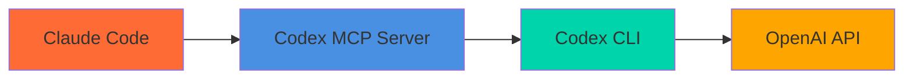

# Codex MCP Server

## Install (SHA-256)

Pin GitHub Release **v0.6.0** and verify `SHA256SUMS`. Website `install.sh` / `install.ps1` abort on mismatch.

https://github.com/LinespottingOrg/GrokBuildRemote-Agents/releases/tag/v0.6.0
https://github.com/LinespottingOrg/GrokBuildRemote-Agents/blob/main/docs/PINNED-INSTALL.md

```
96cef605d3e030ccef99d27ea6240e0d3b668dd045e6b5b9e585c9fd03c6ef23  gbr-agent-darwin-amd64
de7e065ef2cf6877b3b2cd04679a67b627f876337f529247e236204543e4062c  gbr-agent-darwin-arm64
a50a5c41993e6531a3b477eb409ccc845212bf541384dc803061c80657f86719  gbr-agent-linux-amd64
5bfd22c7110234942c4c02ff8154b836d0af45a9422c178a4f52010187d40061  gbr-agent-linux-arm64
f773b89fd31310172b756e0593e0f3b2382b0a3440af2a7d0a8b3073b0c23e27  gbr-agent-windows-amd64.exe
8fb9efcbc7e2ac91c11964944bf0f45e31bb23f4356d9dcb4b305d7cb9b0fe8c  gbr-agent-windows-arm64.exe
```

```bash
VER=v0.6.0
BASE=https://github.com/LinespottingOrg/GrokBuildRemote-Agents/releases/download/$VER
# swap darwin-arm64 for your OS/arch
curl -fsSL -o gbr-agent-darwin-arm64 "$BASE/gbr-agent-darwin-arm64"
curl -fsSL -o SHA256SUMS "$BASE/SHA256SUMS"
shasum -a 256 -c SHA256SUMS --ignore-missing
gbr-agent pair && gbr-agent run
```


[](https://www.npmjs.com/package/codex-mcp-server)
[](https://www.npmjs.com/package/codex-mcp-server)
[](https://www.npmjs.com/package/codex-mcp-server)

Bridge between Claude and OpenAI's Codex CLI — get AI-powered code analysis, generation, and review right in your editor.



## Quick Start

### 1. Install Codex CLI

```bash
npm i -g @openai/codex
codex login --api-key "your-openai-api-key"
```

### 2. Add to Claude Code

```bash
claude mcp add codex-cli -- npx -y codex-mcp-server
```

### 3. Start Using

```
Ask codex to explain this function
Use codex to refactor this code for better performance
Use review to check my uncommitted changes
```

## One-Click Install

[](https://vscode.dev/redirect/mcp/install?name=codex-cli&config=%7B%22type%22%3A%22stdio%22%2C%22command%22%3A%22npx%22%2C%22args%22%3A%5B%22-y%22%2C%22codex-mcp-server%22%5D%7D)
[](https://insiders.vscode.dev/redirect/mcp/install?name=codex-cli&config=%7B%22type%22%3A%22stdio%22%2C%22command%22%3A%22npx%22%2C%22args%22%3A%5B%22-y%22%2C%22codex-mcp-server%22%5D%7D)
[](https://cursor.com/en/install-mcp?name=codex&config=eyJ0eXBlIjoic3RkaW8iLCJjb21tYW5kIjoibnB4IC15IGNvZGV4LW1jcC1zZXJ2ZXIiLCJlbnYiOnt9fQ%3D%3D)

## Tools

| Tool | Description |
|------|-------------|
| `codex` | AI coding assistant with session support, model selection, and structured output metadata |
| `review` | AI-powered code review for uncommitted changes, branches, or commits |
| `websearch` | Web search using Codex CLI with customizable result count and search depth |
| `listSessions` | View active conversation sessions |
| `ping` | Test server connection |
| `help` | Get Codex CLI help |

## Examples

**Code analysis:**
```
Use codex to analyze this authentication logic for security issues
```

**Multi-turn conversations:**
```
Use codex with sessionId "refactor" to analyze this module
Use codex with sessionId "refactor" to implement your suggestions
```
Passing a sessionId creates the session on first use, so listSessions will show
it (for this server instance) and subsequent calls can resume context.

**Code review:**
```
Use review with base "main" to check my PR changes
Use review with uncommitted true to review my local changes
```

**Advanced options:**
```
Use codex with model "o3" and reasoningEffort "high" for complex analysis
Use codex with fullAuto true and sandbox "workspace-write" for automated tasks
Use codex with callbackUri "http://localhost:1234/callback" for static callbacks
Use codex to return structuredContent with threadId metadata when available
```

**Web search:**
```
Use websearch with query "TypeScript 5.8 new features"
Use websearch with query "Rust vs Go performance 2025" and numResults 15
Use websearch with query "React Server Components" and searchDepth "full"
```

## Requirements

- **Codex CLI v0.75.0+** — Install with `npm i -g @openai/codex` or `brew install codex`
- **OpenAI API key** — Run `codex login --api-key "your-key"` to authenticate

## Codex 0.87 Compatibility
- **Thread ID + structured output**: When Codex CLI emits `threadId`, this server returns it in content metadata and `structuredContent`, and advertises an `outputSchema` for structured responses.

## Documentation

- **[API Reference](docs/api-reference.md)** — Full tool parameters and response formats
- **[Session Management](docs/session-management.md)** — How conversations work
- **[Codex CLI Integration](docs/codex-cli-integration.md)** — Version compatibility and CLI details
- **[Build Remote Agent pairing](docs/gbr.md)** — Phone spectator via `gbr-agent` (`127.0.0.1:8788` / gbr-mcp)

## Environment Variables
- `CODEX_MCP_CALLBACK_URI`: Static MCP callback URI passed to Codex when set (overridden by `callbackUri` tool arg)

## Development

```bash
npm install    # Install dependencies
npm run dev    # Development mode
npm run build  # Build for production
npm test       # Run tests
```

## Related Projects

- **[gemini-mcp-server](https://github.com/tuannvm/gemini-mcp-server)** — MCP server for Gemini CLI with 1M+ token context, web search, and media analysis
- **[Clotch](https://github.com/tuannvm/clotch)** — Dynamic Island for Claude Code on macOS — monitor sessions across multiple machines and providers in real time

## License

ISC

## What the phone sees

**Terminal windows** on this PC (machine-wide mailbox). Not headless OpenCode / CodeNomad sidecar / Electron. `:8788` in a sidecar is Bot API JSON, not a transcript.

https://github.com/LinespottingOrg/GrokBuildRemote-Agents/blob/main/docs/WHAT-THE-PHONE-SEES.md
https://grokbuildremote.com/integrations.html
